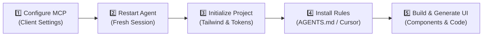

# 🎨 BoardUI MCP Setup Guide

> **Give your AI coding agent access to production-ready UI components**  
> *Component Registry • Design Foundations • Code Examples • Project Setup Tools*

---

## 📌 Overview

**[BoardUI](https://www.boardui.com/)** connects your AI coding agent to a curated registry of UI components, code examples, design foundations, and project setup tools. Once configured via the Model Context Protocol (MCP), your agent can seamlessly discover, inspect, and install components directly into your codebase.

| Resource | Link |
|---|---|
| **Official Website** | [boardui.com](https://www.boardui.com/) |
| **MCP Documentation** | [boardui.com/mcp](https://www.boardui.com/mcp) |
| **Protocol** | Model Context Protocol (MCP) over `stdio` |
| **Package** | `boardui@latest` (via `npx`) |

---

## 🗺️ Integration Workflow



---

## 🚀 Setup & Usage Instructions

### Step 1: Open BoardUI MCP Setup
1. Visit the official documentation at **[boardui.com/mcp](https://www.boardui.com/mcp)**.
2. Navigate to the **Setup** section.
3. Select your AI coding client (e.g., Claude, Cursor, Antigravity, Windsurf, etc.).
4. If your client is not listed, choose **Other clients** and follow the configuration instructions.

---

### Step 2: Configure the MCP Server

For clients supporting custom MCP JSON configurations, add the `boardui` entry to your client's existing MCP settings file:

```json
{
  "mcpServers": {
    "boardui": {
      "command": "npx",
      "args": [
        "-y",
        "boardui@latest",
        "mcp"
      ]
    }
  }
}
```

> [!IMPORTANT]
> **Preserve Existing Configuration:** If your configuration file already contains other MCP servers, append the `boardui` key inside `mcpServers` rather than overwriting the entire file.

> [!NOTE]
> The server runs locally through `npx` using the Model Context Protocol over standard input/output (`stdio`). Some clients use different configuration files or formats—always follow your client's specific instructions where they differ.

---

### Step 3: Restart Your Coding Agent

After saving the configuration:
1. Restart your coding client or open a fresh chat/session.
2. Ask your agent to verify that BoardUI is available:
   > *"Verify that the BoardUI MCP tools are connected and list available tools."*
3. If it reports a connection issue or cannot access the tools, fully restart the client and start a new session.

> [!TIP]
> MCP tools bind when a session starts. Adding the server during an active session may leave its tools unavailable until a new session begins.

---

### Step 4: Initialize BoardUI in Your Project

Open your existing project and prompt your AI coding agent:

```text
Initialize BoardUI in this project. Inspect the existing framework, package configuration, and styling setup first. Use the BoardUI MCP tools to initialize the required dependencies, theme, global styles, utilities, and design rules. Preserve existing functionality and avoid overwriting unrelated project configuration.
```

- The `init_boardui` tool configures Tailwind CSS v4, runtime dependencies, theme foundations, global styles, and utilities.
- Review proposed changes and verify that the project builds cleanly.

---

### Step 5: Install Persistent Design Rules

MCP tools are available when the agent chooses to call them. For consistent output across sessions, BoardUI installs persistent design rules directly into your project files.

Ask your agent:

```text
Use BoardUI MCP to install or refresh the persistent design rules in this project. Apply the recommended semantic color tokens, typography scale, spacing, border-radius conventions, dark-mode guidance, and component utility conventions. Preserve unrelated content in existing instruction files.
```

- **Output locations:**
  - Adds a managed section to `AGENTS.md`
  - Adds a Cursor rule at `.cursor/rules/boardui.mdc`
- Existing projects can also trigger this via the `install_rules` MCP tool.

---

### Step 6: Build UI with BoardUI

Prompt your agent to create full pages or components:

```text
Build a professional analytics dashboard in this project using BoardUI. First inspect the available components and usage examples through MCP. Initialize the project if needed, then install the appropriate components. Follow the project's persistent design rules, use consistent spacing and typography, apply a cohesive color palette, and ensure the layout is responsive. Reuse existing functionality and verify the implementation.
```

#### Available BoardUI MCP Tools

| Tool | Description |
|---|---|
| `list_components` | Discover available components in the registry |
| `get_component` | Retrieve component source code and required dependencies |
| `get_usage_examples` | Read working real-world implementation examples |
| `install_components` | Install components and automatically add missing npm dependencies |
| `get_theme` | Inspect theme tokens, typography, and color scales |

---

### Step 7: (Optional) Install the BoardUI Agent Skill

For deeper, always-loaded knowledge of BoardUI's component catalog, theming system, and design patterns, install the agent skill alongside MCP.

Run the CLI command:
```bash
npx boardui@latest skill
```

Alternatively, ask your agent to use the `install_skill` MCP tool. The default documented MCP installation location is `.claude/skills/`.

---

### Step 8: Free vs. Pro Components

BoardUI provides both free and Pro items within its registry:

| Tier | Access Details |
|---|---|
| 🆓 **Free Components** | Fully accessible without license configuration. |
| 💎 **Pro Components** | Agent can view descriptions and public examples without a license; full source code requires an active license. |

#### License Activation
After purchasing Pro, ask your agent:
> *"Activate my BoardUI license using the `activate_license` tool."*

> [!CAUTION]
> **Security Notice:** Do not share your license key publicly or commit it into source control / Git repositories.

---

## 🛠️ Troubleshooting

| Issue | Root Cause | Solution |
|---|---|---|
| **Server connected, but tools are missing** | Session initialized before MCP registration. | Restart coding client or start a fresh session/chat. |
| **Agent generates generic styling instead of BoardUI** | Agent lacking context or tokens. | Prompt agent to call `get_theme`, inspect available components, and follow persistent design rules. Installing the agent skill (`npx boardui@latest skill`) provides additional context. |
| **Components install, but the application does not run** | Dependency/alias mismatch or broken build. | Inspect package dependencies, framework configuration, import aliases, and global styles. Run `npm run build` or dev checks and resolve missing imports. |
| **Monorepo setup issues** | MCP running in root instead of target package. | Place the optional `boardui.json` beside the destination package's `package.json`. Pass that package's absolute path as `projectDir` to the setup, installation, and read tools. |

---

## ✅ Final Checklist

- [ ] BoardUI MCP server configured in client settings.
- [ ] Coding client restarted or fresh session opened.
- [ ] BoardUI initialized in target project (`init_boardui`).
- [ ] Persistent design rules installed (`AGENTS.md` / `.cursor/rules/boardui.mdc`).
- [ ] Required components and examples inspected.
- [ ] Application builds and renders cleanly without errors.

---

> [!NOTE]
> **The Goal:** Give your AI both the components it can use and the persistent design guidance it needs to use them consistently. BoardUI establishes the design and component foundation, while your prompts, architectural choices, and verification ensure the final UI quality.
