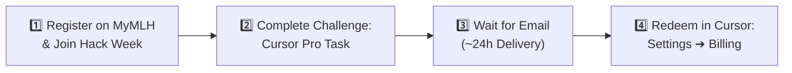

# ⚡ Cursor Pro — Free Claim Guide

> **Unlock 1 Month of Cursor Pro ($20 Value) for Free**  
> *No Student ID Required • Global Hack Week: Hacktoberfest • Open Worldwide*

---

## 📌 Executive Summary

| Attribute | Details |
|---|---|
| **Value** | **$20.00 / month** (100% Free) |
| **Provider** | **Major League Hacking (MLH)** × **Cursor** |
| **Event** | **Global Hack Week: Hacktoberfest / Open Source** |
| **Eligibility** | **Worldwide** • New & Expired Cursor Accounts |
| **Student ID Needed?** | ❌ **No Student ID Required** (Open to all developers) |
| **Code Delivery** | 📧 Email within ~24 hours after challenge completion |
| **Official Event Link** | [events.mlh.com/events/14553-global-hack-week-open-source](https://events.mlh.com/events/14553-global-hack-week-open-source) |
| **Deadline** | ⚠️ **October 15** *(Register by October 14 to guarantee code delivery)* |

---

## 🗺️ Claim Workflow Overview



---

## 🚀 Step-by-Step Claim Instructions

### Step 1: Sign Up on MyMLH & Register for the Event
1. Head to the official MLH event page:  
   👉 **[Global Hack Week: Open Source Event Page](https://events.mlh.com/events/14553-global-hack-week-open-source)**
2. Click **Register** or **Sign In** using your **MyMLH** account (create one in 60 seconds if you haven't already).
3. Complete the registration for **Global Hack Week: Hacktoberfest / Open Source**.

---

### Step 2: Complete the Cursor Pro Challenge
1. Once logged into the Global Hack Week dashboard, navigate to the **Challenges** section.
2. Locate the challenge titled:  
   🎯 **“Sign up for a Cursor Pro account”**
3. Follow the on-screen prompt to submit/complete this challenge.  
   *(Ensure the email you provide matches your active email where you can receive the code).*

---

### Step 3: Wait for the Delivery Email
1. The MLH team distributes codes in scheduled batches. Delivery typically takes **around 24 hours**.
2. Keep an eye on your inbox for an email from **Major League Hacking (MLH)** containing your unique redemption code.

> [!TIP]
> **Can't find the email after 24 hours?**
> - Check your **Spam**, **Junk**, and **Promotions** folders.
> - Search your inbox specifically for the keyword: `"MLH"` or `"Cursor"`.

---

### Step 4: Redeem in Cursor
1. Open the **Cursor** app on your desktop (or visit [cursor.com](https://www.cursor.com)).
2. Navigate to:
   ```
   Cursor ➔ Settings ➔ Billing
   ```
3. Locate the **Promo Code / Coupon** redemption field.
4. Paste your unique MLH promo code and click **Apply** / **Redeem**.
5. Your account will immediately reflect **Cursor Pro** active status! 🎉

---

## ⚠️ Important Things to Know

> [!IMPORTANT]
> - **One Code Per Person:** Codes are single-use and limited to one per participant.
> - **Account Compatibility:** The promo is reported to work seamlessly for both **new accounts** and **accounts with an expired Pro subscription**.
> - **Strict Cut-Off Window:** The stated deadline is **October 15**. Because code processing and dispatch can take up to 24 hours, **register by October 14** to avoid missing the delivery cut-off.

---

## 📋 Claim Checklist

- [ ] Created or logged into **MyMLH** account
- [ ] Registered for **Global Hack Week: Open Source**
- [ ] Submitted the **“Sign up for a Cursor Pro account”** challenge
- [ ] Monitored inbox + spam folder for `"MLH"`
- [ ] Redeemed code under `Cursor ➔ Settings ➔ Billing`
- [ ] Confirmed Pro subscription status in Cursor dashboard

---

## 🔗 Direct Access Links

- 🌐 **Event Portal:** [MLH Global Hack Week Open Source Registration](https://events.mlh.com/events/14553-global-hack-week-open-source)
- 💻 **Cursor Dashboard:** [cursor.com/settings](https://www.cursor.com/settings)

---

> [!NOTE]
> *Disclaimer: Promotional offers, partner perks, and availability are managed directly by Major League Hacking and Cursor. Terms and availability can change at any time. Always verify the current event requirements on the official MLH event page before registering.*
